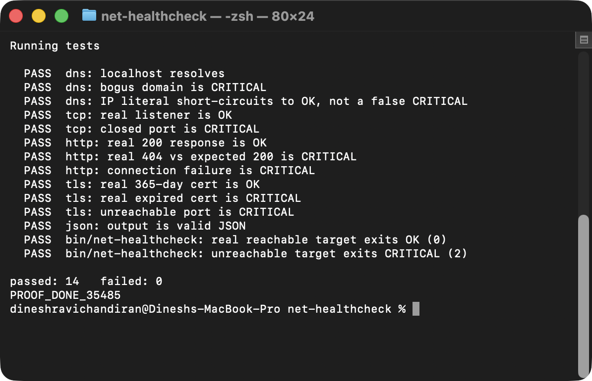

# net-healthcheck

OSI-layer connectivity diagnostics for a target host: DNS resolution, TCP
reachability, HTTP(S) reachability, and TLS certificate expiry, all in one
Nagios-convention exit code so any monitoring agent can consume it directly.

## Why this exists

"Is it a DNS problem, a routing problem, or is the app just down?" is one of
the first questions in almost any incident, and it's usually answered by
running four or five different commands by hand — `dig`, then `nc -z`, then
`curl -v`, then squinting at `openssl s_client` output for a certificate
date. This runs all four checks in one pass and reports the single worst
result, the same way a Nagios/Icinga check plugin would.

## Design decisions

**Read-only, always.** This is a pure diagnostic tool — there's nothing to
apply or roll back. It never modifies anything it checks.

**Nagios-convention exit codes.** `0` OK, `1` WARNING, `2` CRITICAL, `3`
UNKNOWN, so the worst single result from a batch of checks becomes the
process exit code.

**Degrades instead of failing.** If `dig` isn't installed, DNS checks fall
back to `host`, then a `python3` socket lookup, and report UNKNOWN only if
none of them are available — the same "degrade, don't crash" pattern as the
rest of the ops-toolkits family.

**No mocks in the test suite.** Every check is tested against something
real: a real local HTTP server, a real closed TCP port, and a real
`openssl`-generated certificate — including one with a genuinely past
expiry date — served over a real TLS socket via `openssl s_server`.

## Bugs this caught

Three real, otherwise-invisible bugs surfaced by testing against real
targets instead of assuming the logic was right:

1. **`/dev/tcp` doesn't work on macOS's shipped bash.** The first version of
   the TCP check used bash's built-in `/dev/tcp/host/port` redirection —
   the standard "no dependencies" way to test a TCP connection in bash.
   Except Apple's shipped `/bin/bash` (3.2.57) is compiled **without**
   `--enable-net-redirections`, so `/dev/tcp/...` fails with a plain "no
   such file or directory" — no error message hints it's a compile-time
   flag rather than a real path. This produced a false CRITICAL against a
   host that was actually fully reachable (confirmed by the HTTP and TLS
   checks succeeding against the same host in the same run). Fixed by
   using `nc -z` (ships with macOS) with a `python3` socket fallback.
2. **DNS-checking an IP literal always failed.** `dig +short 127.0.0.1`
   queries `127.0.0.1` as a *hostname*, not a reverse lookup — there's no
   implicit PTR lookup — so it returns nothing and the DNS check reported a
   false CRITICAL "did not resolve" for any target that was already an IP
   address. Fixed with an `is_ip_literal` check that short-circuits DNS
   checking to OK when the target is already an IP.
3. **Job-control noise on killed background test servers.** The test
   suite's cleanup trap `kill`s the local HTTP/TLS servers it starts, which
   made bash print `Terminated: 15` for each one at the next prompt —
   harmless, but looks like a failure on a quick skim. Fixed by `disown`ing
   each background PID right after starting it.

## What's new: a Go version (`go/`)

The same tool rewritten in Go, standard library only, with the same flags, output and Nagios exit codes, plus
per-check timeouts (`context`), concurrent checks (`--workers`), a JSON config, a one-line Nagios mode with
performance data, and a 14.5 MB container image.

```bash
cd go
make test      # go test -race -cover   (94.7% and 97.7% statement coverage on the last run)
make build     # ./dist/net-healthcheck
make cross     # linux/amd64, linux/arm64, darwin/arm64
make docker    # small non-root image
./dist/net-healthcheck --host example.com --port 443 --url https://example.com --nagios
bash scripts/parity.sh   # run Bash and Go against the same targets: 12 of 12 identical on the last run
```

Evidence from real runs is in `docs/evidence/`; the comparison is in [docs/PARITY.md](docs/PARITY.md);
interview notes are in [docs/INTERVIEW-NOTES.md](docs/INTERVIEW-NOTES.md).
Honest status: the GitHub Actions workflow for the Go code (`.github/workflows/go.yml`) is written and its YAML parses,
but it has **not run on GitHub yet**; everything above was run locally.

## Usage

```bash
# Single target
./bin/net-healthcheck --host github.com --port 443 --url https://github.com

# Multiple targets from a config file
./bin/net-healthcheck --config conf/targets.conf.example

# Machine-readable output for a monitoring agent
./bin/net-healthcheck --host github.com --port 443 --json
```

### Example output

```
[OK      ] dns:github.com         resolved to 20.207.73.82 (via dig)
[OK      ] tcp:github.com:443     connected in 54ms (via nc)
[OK      ] http:https://github.com HTTP 200 in 0.160s
[OK      ] tls:github.com:443     certificate valid for 73d (Nov 29 23:59:59 2026 GMT)

worst status: OK
```

## Test proof

Real terminal screenshot, not pasted text — a genuine `screencapture` of a
Terminal.app window running the actual suite, taken right after the run
finished.

**net-healthcheck — 14/14**


## Requirements

Bash 3.2+ and standard coreutils. `curl` for HTTP checks, `openssl` for TLS
certificate checks, and `dig` or `host` (falling back to `python3`) for DNS
resolution — all present on a stock macOS or most Linux installs.
